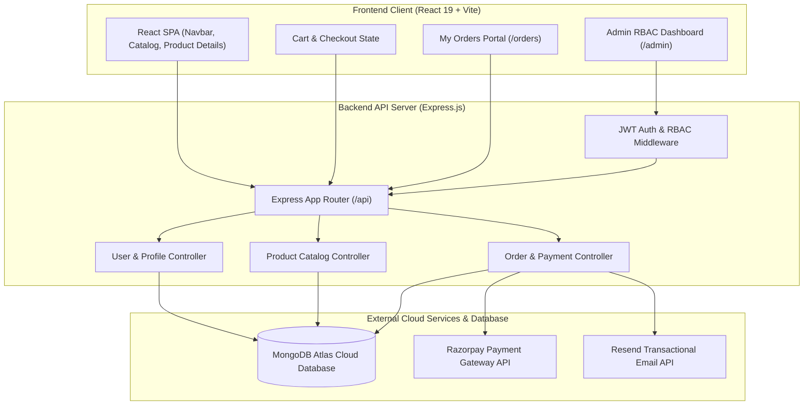
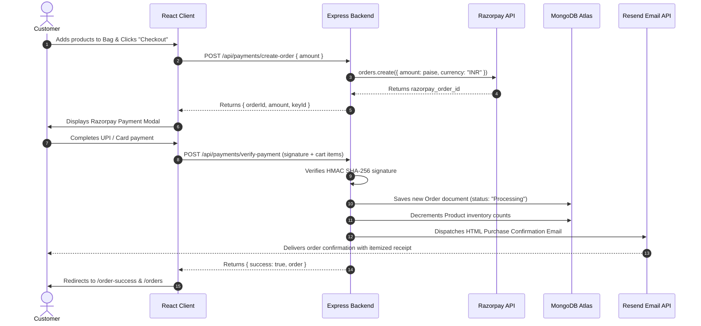
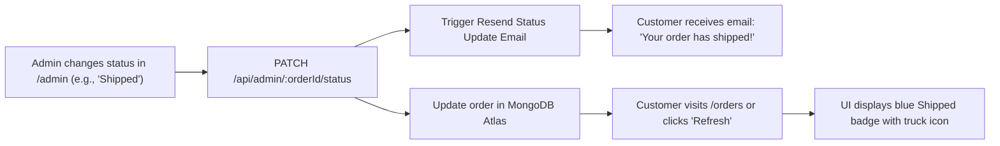
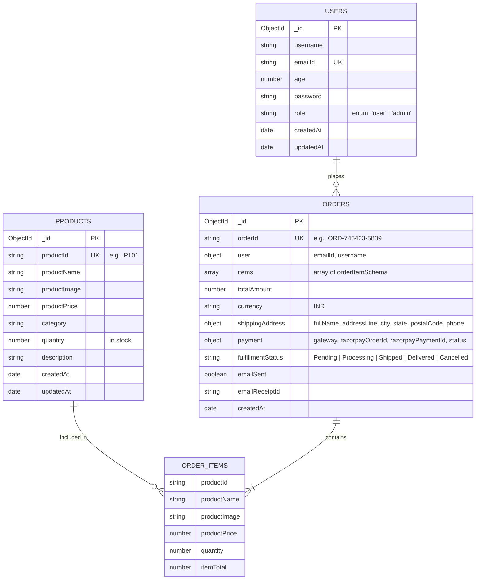

# Cartify — Full-Stack E-Commerce & Retail Management Platform

A modern, high-performance **MERN Stack** e-commerce platform engineered with a minimalist aesthetic, end-to-end payment integration, multi-stage automated email notifications, customer order tracking, and a comprehensive Role-Based Access Control (RBAC) administrative portal.

---

## Table of Contents
1. [Core Features](#-core-features)
2. [Technology Stack](#-technology-stack)
3. [System Architecture Diagrams](#-system-architecture-diagrams)
4. [Database Design & ER Diagram](#-database-design--er-diagram)
5. [Complete REST API Specification](#-complete-rest-api-specification)
6. [Project Structure](#-project-structure)
7. [Environment Variables](#-environment-variables)
8. [Getting Started & Local Setup](#-getting-started--local-setup)
9. [Pre-configured Demo Credentials](#-pre-configured-demo-credentials)
10. [Client-Side Routes & Sitemap](#-client-side-routes--sitemap)
11. [Testing & Verification Guide](#-testing--verification-guide)

---

## 🚀 Core Features

### 1. Storefront & Catalog Discovery
* **Dynamic Multi-Category Filtering**: Instant client-side filtering across departments (All, Electronics, Footwear, Accessories, Bags, Audio, Apparel, Home & Living, Beauty).
* **Live Search**: Instant substring search querying both titles and product descriptions.
* **Dedicated Product URLs**: Clean, bookmarkable URLs (`/products/:id`) for every item with detailed photo galleries, star ratings, specs, and stock indicators.
* **Flyout Shopping Cart Drawer**: Slide-over drawer with real-time price subtotal calculations, item quantity increment/decrement, and persistent local state.

### 2. Payment Gateway (Razorpay Integration)
* **Secure Two-Step Checkout**:
  1. **Order Initiation (`POST /api/payments/create-order`)**: Computes subtotal in paise and generates a signed Razorpay order ID.
  2. **Payment Verification (`POST /api/payments/verify-payment`)**: Cryptographically validates payment authenticity via **HMAC SHA-256** signatures (`razorpay_order_id|razorpay_payment_id` against `RAZORPAY_KEY_SECRET`).
* **Inventory Stock Decrement**: Automatically decrements product inventory in MongoDB upon successful verification.

### 3. Automated Email Notification Engine (Resend API)
* **Signup Welcome Email**: Automatically dispatches a welcome onboarding email upon registration via `noreply@sreeaditya.tech`.
* **Itemized Purchase Confirmation**: Generates a branded HTML receipt containing order reference, full itemized breakdown (item, quantity, unit price, line total), delivery address, and Razorpay payment reference.
* **Live Order Status Updates**: Automatically notifies customers via email when an administrator marks their order as **Shipped** or **Delivered**.

### 4. Customer "My Orders" Dashboard (`/orders`)
* **Real-Time Order History**: Displays full past orders associated with the authenticated customer's email.
* **Color-Coded Status Badges**:
  * ⏱️ **Processing** &rarr; Amber badge
  * 🚚 **Shipped** &rarr; Blue badge with transit truck icon
  * ✅ **Delivered** &rarr; Green badge with checkmark icon
* **Status Category Filter Tabs**: Live filter tabs (`All Orders`, `Processing`, `Shipped`, `Delivered`) with dynamic count badges.
* **Live Order Tracking**: Instant "Refresh" action fetching up-to-the-minute updates directly from MongoDB Atlas.

### 5. Store Administration & RBAC Portal (`/admin`)
* **Financial & Inventory Analytics**: Gross revenue metrics, order totals, catalog counts, and warehouse unit inventory tallies.
* **Revenue by Department**: Visual bar charts displaying sales contribution per department.
* **Manage Customer Orders**: Interactive order table allowing administrators to transition fulfillment statuses (`Pending` &rarr; `Processing` &rarr; `Shipped` &rarr; `Delivered` &rarr; `Cancelled`).
* **Catalog Inventory Management**:
  * **Add New Product**: Supports custom/auto-generated SKUs, department assignment, pricing, stock count, and Unsplash presets.
  * **Edit Existing Product**: In-place modal dialog to update product titles, categories, pricing, stock levels, images, and descriptions.
  * **Delete Product**: Secure removal with confirmation prompts.
  * **Configurable Pagination**: Customizable items-per-page (4, 6, 8, 12 items) with responsive page navigators.
* **Cash & Transactions Ledger**: Audit log detailing payment IDs, customers, amounts, and settlement dates.

### 6. Security, Authentication & User Profile Management
* **Role-Based Access Control (RBAC)**: Distinguishes between standard customers (`role: "user"`) and store managers (`role: "admin"`).
* **Cryptographic Passwords**: Passwords hashed using `bcryptjs` with salt rounds.
* **Stateless JWT Authorization**: Secure `Bearer` tokens verifying user identity on protected routes.
* **Full Profile Lifecycle (RESTful)**: Supports complete replacement (`PUT`), partial updates (`PATCH`), and account deletion (`DELETE`).

### 7. UI/UX Design System
* **Theme Switcher**: Dark Mode and Light Mode with persistent `localStorage` preference.
* **Unified Branding**: Custom brand logo (`/logo.png`) seamlessly integrated into the browser favicon, apple touch icon, navbar, login/registration dialogs, admin portal, and footer.
* **Iconography**: Phosphor Icons (`@phosphor-icons/react`) for accessible visuals.

---

## 🛠 Technology Stack

### Frontend Architecture
| Layer | Technology | Purpose |
| :--- | :--- | :--- |
| **Framework** | React 19 (`^19.3.1`) | Component-driven UI rendering |
| **Build Tool** | Vite 8 (`^8.3.5`) | Ultra-fast HMR and optimized production bundling |
| **Routing** | React Router v7 (`^7.18.5`) | Client-side dynamic routing (`BrowserRouter`, `Routes`, `Route`) |
| **Icons** | Phosphor Icons (`^2.1.10`) | Clean SVG iconography |
| **Styling** | Custom CSS3 | Modern CSS design tokens, responsive CSS grid/flexbox, dark/light themes |

### Backend Architecture
| Layer | Technology | Purpose |
| :--- | :--- | :--- |
| **Runtime** | Node.js (v18+) | Server-side JavaScript runtime |
| **Web Framework** | Express.js (`^5.3.0`) | RESTful API routing, middleware, and request handling |
| **Database ORM** | Mongoose (`^9.11.4`) | Object Data Modeling (ODM) for MongoDB Atlas |
| **Authentication** | JWT (`jsonwebtoken`) & `bcryptjs` | Token generation and secure password hashing |
| **Payment Gateway** | Razorpay Node SDK (`^2.9.8`) | Order creation and cryptographic HMAC validation |
| **Email Service** | Resend API (`POST https://api.resend.com`) | Transactional and status update email notifications |

---

## 📊 System Architecture Diagrams

### 1. High-Level System Architecture


---

### 2. End-to-End Checkout & Order Lifecycle Sequence


---

### 3. Admin Fulfillment & Live Customer Status Sync Flow


---

## 🗄 Database Design & ER Diagram

### Entity-Relationship Diagram


---

## 🔌 Complete REST API Specification

### 1. Authentication & User Profile Management
| Method | Endpoint | Access | Headers / Query | Request Body | Description |
| :--- | :--- | :--- | :--- | :--- | :--- |
| **POST** | `/api/users` | Public | None | `{ username, emailId, age, password, role? }` | Register a new customer or admin. Dispatches welcome email. |
| **POST** | `/api/login` | Public | None | `{ emailId, password }` | Authenticates user; returns JWT token and profile info. |
| **GET** | `/api/users` | User/Admin | `?emailId=...` | None | Fetch user account details. |
| **PUT** | `/api/users` | User/Admin | `?emailId=...` | `{ username, age, password }` | Full update of customer profile details. |
| **PATCH** | `/api/users` | User/Admin | `?emailId=...` | `{ username?, age?, password? }` | Partial update of customer profile details. |
| **DELETE**| `/api/users` | User/Admin | `?emailId=...` | None | Deletes user record from database. |

### 2. Product Catalog Management
| Method | Endpoint | Access | Headers / Query | Request Body | Description |
| :--- | :--- | :--- | :--- | :--- | :--- |
| **GET** | `/api/products` | Public | `?category=...` | None | Fetch all catalog products or filter by department. |
| **GET** | `/api/products/:id` | Public | None | None | Fetch single product by `productId` (e.g. `P101`). |
| **POST** | `/api/products` | Admin Only | `Bearer <token>` | `{ productId?, productName, category, productPrice, quantity, productImage?, description? }` | Adds a new product to the catalog. |
| **PATCH**| `/api/products/:id` | Admin Only | `Bearer <token>` | `{ productName?, category?, productPrice?, quantity?, productImage?, description? }` | Updates existing product details. |
| **PUT**  | `/api/products/:id` | Admin Only | `Bearer <token>` | `{ productName, category, productPrice, quantity, productImage, description }` | Full replacement of existing product. |
| **DELETE**| `/api/products/:id` | Admin Only | `Bearer <token>` | None | Removes a product from the live catalog. |

### 3. Payments, Orders & Fulfillment
| Method | Endpoint | Access | Headers / Query | Request Body | Description |
| :--- | :--- | :--- | :--- | :--- | :--- |
| **POST** | `/api/payments/create-order` | User | `Bearer <token>` (opt) | `{ amount, currency?, receipt? }` | Initializes a Razorpay order in paise. |
| **POST** | `/api/payments/verify-payment` | User | `Bearer <token>` (opt) | `{ razorpay_order_id, razorpay_payment_id, razorpay_signature, items, totalAmount, shippingAddress, customerEmail, customerName }` | Validates HMAC signature, saves order, decrements stock, and sends confirmation email. |
| **GET** | `/api/orders/my-orders` | User | `Bearer <token>` or `?emailId=...` | None | Retrieves complete past order history for the user. |
| **GET** | `/api/orders/:orderId` | User/Admin | None | None | Retrieves order breakdown by `orderId`. |
| **GET** | `/api/admin/all` | Admin Only | `Bearer <token>` | None | Retrieves all orders across all customers. |
| **PATCH**| `/api/admin/:orderId/status` | Admin Only | `Bearer <token>` | `{ fulfillmentStatus }` | Updates order fulfillment (`Shipped`, `Delivered`, etc.) and sends status update email. |
| **GET** | `/api/admin/analytics` | Admin Only | `Bearer <token>` | None | Aggregates revenue, department sales, order metrics, and recent transactions. |

---

## 📂 Project Structure

```text
Cartify/
├── backend/
│   ├── config/
│   │   └── db.js                 # MongoDB connection logic via Mongoose
│   ├── data/
│   │   └── seedData.js           # 16 curated catalog products & auto-seed utility
│   ├── models/
│   │   ├── User.js               # User schema (roles: 'user' | 'admin')
│   │   ├── Product.js            # Product catalog schema
│   │   └── Order.js              # Order schema (items, payments, fulfillment)
│   ├── routes/
│   │   ├── userRoutes.js         # Auth, Welcome email, and REST profile routes
│   │   ├── productRoutes.js      # Product catalog, CRUD, and admin update handlers
│   │   └── orderRoutes.js        # Razorpay gateway, Resend email logic, admin orders
│   ├── .env                      # Secret keys and connection strings (gitignored)
│   ├── package.json              # Backend dependencies and scripts
│   └── server.js                 # Express server configuration and route mounting
│
├── frontend/
│   ├── public/
│   │   ├── logo.png              # Primary brand logo asset (used in favicon & UI)
│   │   └── vite.svg
│   ├── src/
│   │   ├── components/
│   │   │   ├── Navbar.jsx                # Global navigation bar with logo and state badges
│   │   │   ├── ProductCatalog.jsx        # Storefront grid, department filter, and search
│   │   │   ├── ProductCard.jsx           # Individual product card preview
│   │   │   ├── ProductDetailPage.jsx     # Dedicated product page (/products/:id)
│   │   │   ├── CartDrawer.jsx            # Flyout slide-over cart drawer
│   │   │   ├── CheckoutPage.jsx          # Dedicated checkout screen with address capture
│   │   │   ├── OrderSuccessPage.jsx      # Order confirmation with direct link to orders
│   │   │   ├── UserOrdersPage.jsx        # Customer "My Orders" tracking portal (/orders)
│   │   │   ├── AdminDashboard.jsx        # RBAC dashboard (analytics, orders, catalog CRUD)
│   │   │   ├── UserLogin.jsx             # Login dialog with quick-fill demo buttons
│   │   │   ├── UserRegistration.jsx      # Registration dialog with validation
│   │   │   └── UserProfileManagement.jsx # REST API profile modification modal
│   │   ├── App.jsx                       # Root router configuration & global state
│   │   ├── index.css                     # Design system, variables, and dark/light modes
│   │   └── main.jsx                      # Vite entry point
│   ├── index.html                        # HTML template with /logo.png favicon
│   ├── vite.config.js                    # Vite configuration with /api backend proxy
│   └── package.json                      # Frontend dependencies
│
├── package.json                          # Root package.json with concurrent scripts
└── README.md                             # Comprehensive project documentation
```

---

## ⚙️ Environment Variables

Create a `.env` file in the `backend/` directory with the following variables:

```env
# Server Port
PORT=5000

# MongoDB Atlas Database Connection URI
MONGO_URI=mongodb+srv://<username>:<password>@cluster0.mongodb.net/cartify?retryWrites=true&w=majority

# JWT Token Secret Key
JWT_SECRET=cartify_jwt_secret_key_change_me

# Razorpay Test API Keys
RAZORPAY_KEY_ID=rzp_test_TBk2cz1k0IdiW4
RAZORPAY_KEY_SECRET=Ki4wmCXQzOnissELm0N3Mzla

# Resend Transactional Email API Configuration
RESEND_API_KEY=re_6u2BZ5An_621ZyZ3tQBFVXTPhgjBoqsb5
MAIL_FROM=noreply@sreeaditya.tech
```

---

## 🏃 Getting Started & Local Setup

### 1. Clone the Repository
```bash
git clone https://github.com/<your-username>/Cartify.git
cd Cartify
```

### 2. Install Dependencies
```bash
# Install root dependencies
npm install

# Install backend dependencies
cd backend && npm install

# Install frontend dependencies
cd ../frontend && npm install
```

### 3. Launch Development Servers

You can launch both servers simultaneously or in separate terminal sessions:

#### Option A: Run Separately
```bash
# Terminal 1: Backend Server (runs on http://localhost:5000)
cd backend
npm run dev

# Terminal 2: Frontend Client (runs on http://localhost:3000)
cd frontend
npm run dev
```

#### Option B: Run Concurrently from Root
```bash
npm run backend   # Starts nodemon on port 5000
npm run frontend  # Starts vite on port 3000
```

---

## 🔑 Pre-configured Demo Credentials

For quick evaluation, one-click auto-fill buttons are provided directly on the **Sign In** dialog (`/login`):

| Role | Email ID | Password | Access Capabilities |
| :--- | :--- | :--- | :--- |
| **Customer** | `shonlyforstudies@gmail.com` | `demo123` | Browsing, cart drawer, Razorpay checkout, live order history, status tracking (`/orders`), profile management. |
| **Administrator** | `admin@cartify.com` | `admin123` | Full RBAC portal (`/admin`), revenue analytics, fulfillment status changes, product catalog CRUD (Add/Edit/Delete). |

---

## 🧭 Client-Side Routes & Sitemap

| URL Path | Component | Protected | Description |
| :--- | :--- | :--- | :--- |
| `/` | `ProductCatalog` | Public | Home redirect to catalog. |
| `/products` | `ProductCatalog` | Public | Curated catalog with department filter pills and search. |
| `/products/:id` | `ProductDetailPage` | Public | Dedicated item view with gallery, specifications, and add-to-bag. |
| `/checkout` | `CheckoutPage` | Public / User | Order review, shipping address form, and Razorpay gateway. |
| `/order-success` | `OrderSuccessPage` | Public / User | Order confirmation screen with tracking links. |
| `/orders` | `UserOrdersPage` | Auth Required | Customer past orders dashboard, status pills, and receipts. |
| `/admin` | `AdminDashboard` | Admin Only | Full RBAC administrative suite & store metrics. |
| `/login` | `UserLogin` | Public | Login modal with quick-fill demo buttons. |
| `/register` | `UserRegistration` | Public | Customer account creation with welcome email dispatch. |
| `/profile` | `UserProfileManagement` | Auth Required | RESTful profile inspector and editor. |

---

## 🧪 Testing & Verification Guide

### 1. Testing Order Fulfillment Updates
1. Sign in as **Store Administrator** (`admin@cartify.com` / `admin123`).
2. Navigate to `/admin` and click the **Manage Orders** tab.
3. Locate an active order (e.g., `#ORD-...`) and change the **Fulfillment Status** dropdown from `Processing` &rarr; `Shipped`.
4. The backend immediately:
   * Updates the MongoDB Atlas document.
   * Dispatches a branded shipment notification email to the customer via Resend.
5. Sign in as the **Customer** (`shonlyforstudies@gmail.com`) and open `/orders`:
   * Notice the status badge switches to **Shipped** (🚚) in blue.
   * The "Shipped" category filter tab updates its counter.

### 2. Testing Product Edit & Catalog Updates
1. In `/admin`, open the **Add & Manage Products** tab.
2. Under **Current Catalog**, click the **Edit** icon (`<PencilSimple />`) on any product row.
3. Modify the price, stock units, or description, then click **Save Product Changes**.
4. The catalog updates immediately without requiring a full page reload.

---

## 📄 License
This project is developed for educational and demonstration purposes. All rights reserved &copy; 2026 Cartify.
